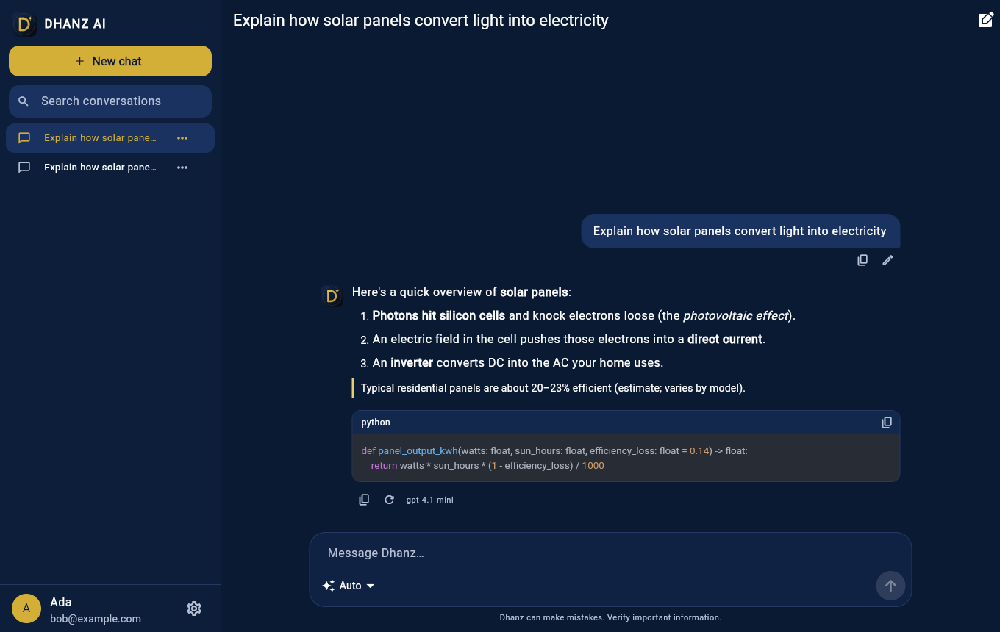
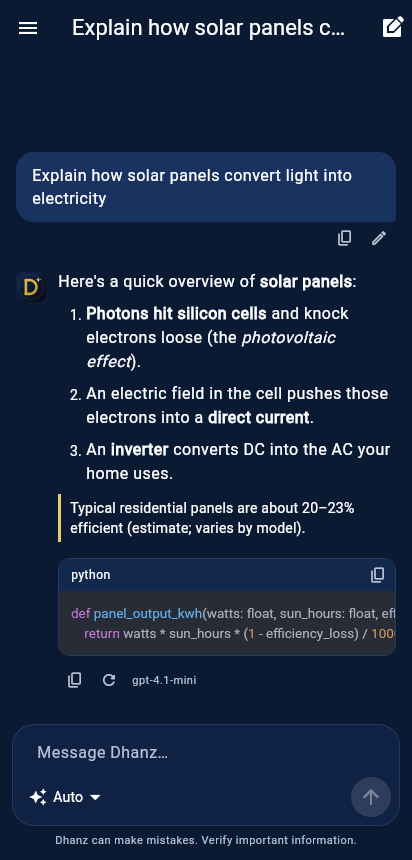
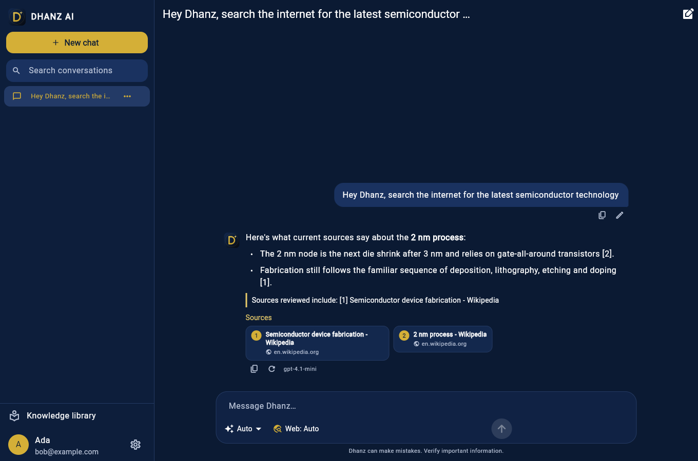
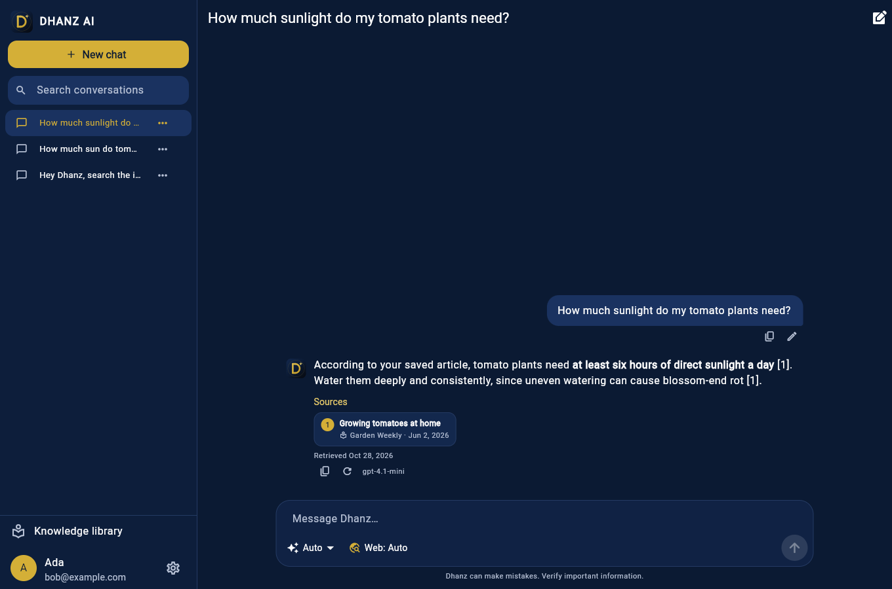

# DHANZ AI

**Your World. Your Knowledge. Your AI.**

## Download for Windows

[Download the DHANZ AI 0.7.0 Windows installer / update](https://github.com/rodsangle/DhanzAI/releases/download/desktop-0.7.0/dhanz-ai-0.7.0-windows-setup.exe)

Close DHANZ AI (including its tray icon) and run the setup EXE. Keep the existing installation
folder selected: setup replaces the application files and retains your shortcuts and user data.
Do not uninstall first. The installer reuses registered installations and defaults to
`%LOCALAPPDATA%\Programs\DHANZ AI` for existing per-user copies. If you previously extracted
a portable ZIP elsewhere, select that folder in setup to update that copy.
This installer is unsigned. The portable ZIP is an optional download, not the normal update path.
See the [release notes](https://github.com/rodsangle/DhanzAI/releases/tag/desktop-0.7.0)
for downloads and checksums. Creative Studio needs an updated backend and configured provider
keys; follow the [setup guide](docs/CREATIVE_STUDIO.md).

DHANZ AI is a cross-platform AI assistant — *Dhanz* — for Windows 10/11, Android and
iPhone/iPad, built with Flutter on top of a FastAPI backend that routes each message to OpenAI,
Anthropic Claude, Google Gemini or a local Ollama model.

> "Hello! I'm Dhanz, your personal AI assistant. How can I help you today?"

| Desktop | Phone |
|---|---|
|  |  |

## Status

**Phase 1 — working MVP:** accounts, multi-provider AI with automatic model routing and
fallback, streaming chat, conversation history (search, rename, pin, export, delete),
regenerate / edit-and-resend / stop, Markdown with code highlighting, light & dark themes,
privacy controls (data export, account deletion), CI and release pipelines.

**Phase 2 — internet intelligence:** live web search (Brave, Tavily or SearXNG), polite page
reading that respects robots.txt and never bypasses paywalls, webpage summarisation, answers
with numbered clickable citations and publication/retrieval dates, and a private knowledge
library with hybrid keyword + semantic (pgvector) retrieval.

In **Knowledge library → Search internet and save**, enter a topic to download readable
public page text into your private library. Saved sources include their links and retrieval
dates and can be previewed and searched later. Repeat searches refresh existing pages;
unreadable sources are reported individually. This requires the backend account mode and a
configured `SEARCH_PROVIDER` (`brave`, `tavily`, or `searxng`) with its key or server URL.
The standalone local chat mode does not provide this library action.

| Web research with sources | Answer from your knowledge library |
|---|---|
|  |  |

**Phase 3 — advanced assistant:** upload and analyse PDF, Word, Excel, PowerPoint, CSV, text,
code and images (vision models), compare documents, exact spreadsheet statistics, optional ClamAV
malware scanning, project workspaces with standing instructions, opt-in long-term memory, a
voice assistant (speech-to-text, spoken replies, hands-free mode, "Hey Dhanz"), and PDF export.

**Phase 4 — platform distribution:** answers keep generating when you leave the app and a
push notification (Android FCM / iOS APNs) says when they are ready; explicit Stop that works across
server workers; Windows system tray, minimize-to-tray, desktop notifications and drag-and-drop;
in-app updates with checksum-verified Windows installers; signed release builds when certificates
are provided. The native push code has not yet been run on real devices; see the roadmap.

**Phase 5 — production readiness:** see and sign out your devices (immediately effective),
password change and email reset, per-account brute-force lockout, Redis-shared rate limits,
auto-deletion of old conversations and temporary chats, an administration screen, request IDs,
JSON logs and Prometheus metrics, coverage gates, dependency audit, CodeQL, a signed server
image and a one-command HTTPS deployment with nightly backups ([docs/DEPLOY.md](docs/DEPLOY.md)).

**Assistant tools:** Dhanz can calculate exactly, convert units, tell the time anywhere and do date
maths, set reminders (with notifications and *Add to calendar*), and draft emails you open and
send from your own email app — using each AI provider's native function calling.

**Public accounts:** email verification by code, two-step verification with any authenticator app
(QR code, recovery codes), and *Continue with Google* (Android, iOS) / *Sign in with Apple* (iOS),
all verified on the server.

Optional local [OCR for scanned PDFs](docs/OCR.md) is implemented; enable it on the backend.
Subscriptions (Free / Plus / Pro), usage limits, cost tracking and the web administrator
dashboard are **not implemented yet** — see [docs/ROADMAP.md](docs/ROADMAP.md) for the exact
status of every feature.

## Quick start

**DHANZ Creative Studio (0.7):** text-to-image, reference edits, asynchronous Runway video,
private creation history, previews/downloads/sharing, server-side credit reservations/refunds,
monthly allowances, moderation and administrator controls. Requires configured provider keys;
generation is disabled by default. See [Creative Studio setup and limitations](docs/CREATIVE_STUDIO.md).
Provider/storage contracts are tested with simulated services; live generation and native playback
still need operator verification before release.

```bash
# 1. Backend (Docker)
cp .env.example .env          # set POSTGRES_PASSWORD, JWT_SECRET, one AI provider key and
                              # (optional) SEARCH_PROVIDER + key for web research
docker compose up -d --build
curl http://localhost:8000/api/v1/health/ready

# 2. App
cd apps/dhanz_flutter
flutter pub get
flutter run -d windows        # or an Android emulator / iOS simulator
```

Full instructions for every platform, including installers, APK/AAB and signed iOS builds:
[docs/INSTALL.md](docs/INSTALL.md).

## Repository layout

```
apps/dhanz_flutter   Flutter app (Windows, Android, iOS; macOS/web scaffolding)
backend              FastAPI API, SQLAlchemy models, Alembic migrations, tests
ai_engine            dhanz_ai package: OpenAI / Anthropic / Gemini / Ollama adapters + orchestrator
knowledge_engine     dhanz_knowledge: search APIs, safe fetching, extraction, embeddings, ranking
database             PostgreSQL init (pgvector, pg_trgm)
tests/e2e            Smoke test against a running API
tests/load           Load test against a running API
deploy               Production stack: Caddy (HTTPS), API, PostgreSQL, Redis, backups
scripts              App icon generator, Windows installer (Inno Setup)
.github/workflows    CI and release builds
docs                 Architecture, install, testing, security, release, roadmap
```

## Documentation

* [Architecture](docs/ARCHITECTURE.md) — components, API, streaming protocol, data model
* [Installation](docs/INSTALL.md) — backend, Windows, Android, iOS, macOS
* [Testing](docs/TESTING.md) — unit, widget, end-to-end, manual checklist
* [Security & privacy](docs/SECURITY.md) — controls in place and known limitations
* [Release](docs/RELEASE.md) — signing, CI secrets, release checklist
* [Deploy & operate](docs/DEPLOY.md) — HTTPS server, backups, monitoring, scaling
* [Roadmap](docs/ROADMAP.md) — phases and implementation status

## Tech stack

Flutter · Dart · Riverpod · GoRouter · Python 3.11+ · FastAPI · SQLAlchemy 2 (async) · Alembic ·
PostgreSQL 16 + pgvector · BeautifulSoup/lxml · Redis (reserved for job queues) · Docker · GitHub Actions.

---

The archives `VideoToMP3.zip` and `VideoToMP3Android.zip` predate DHANZ AI and are kept unchanged.
